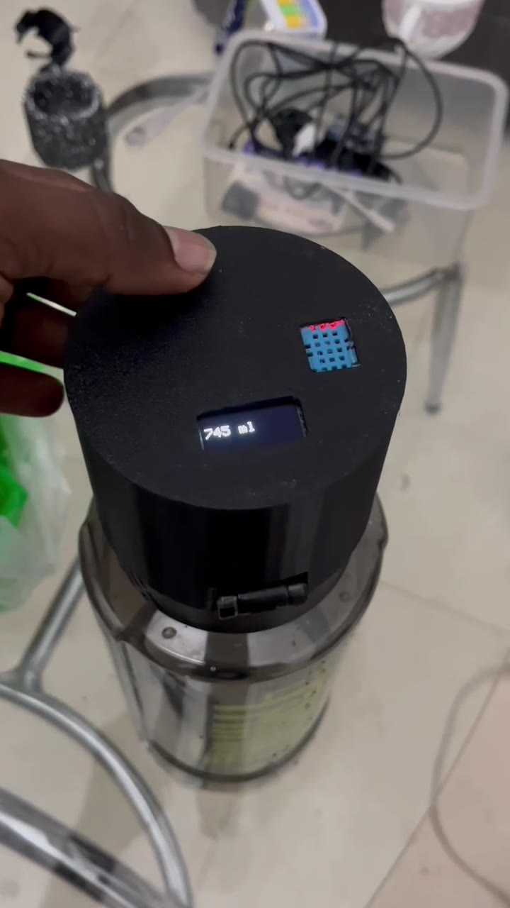
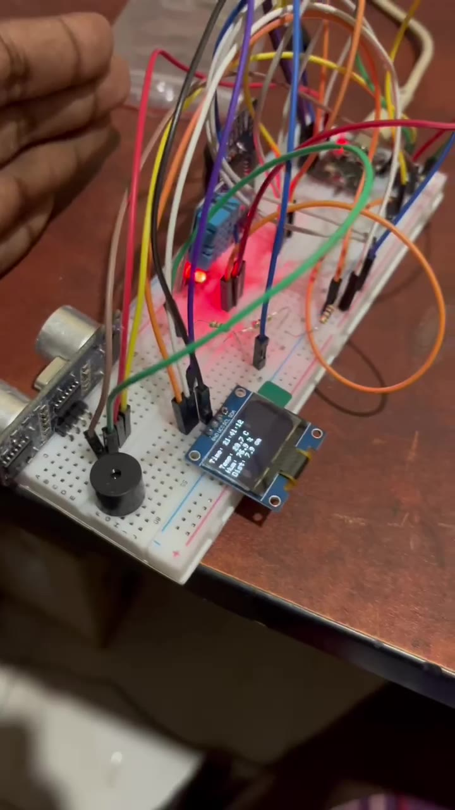
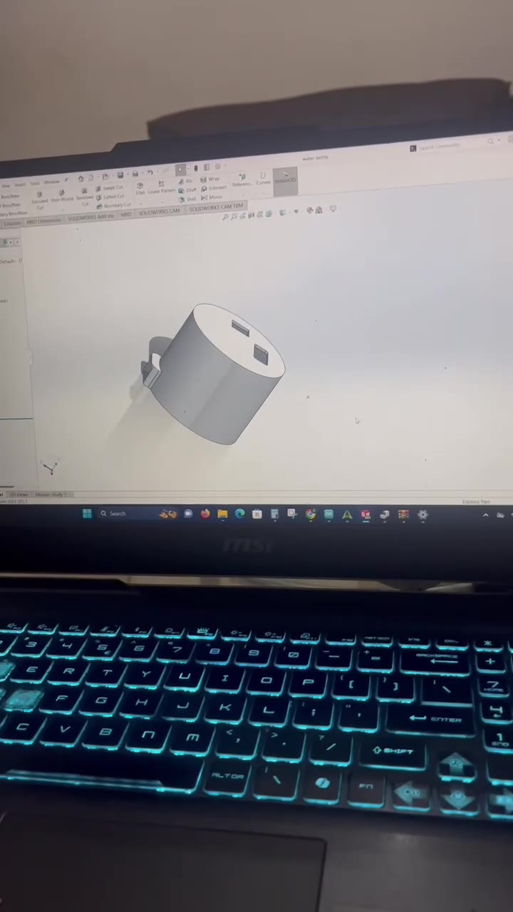
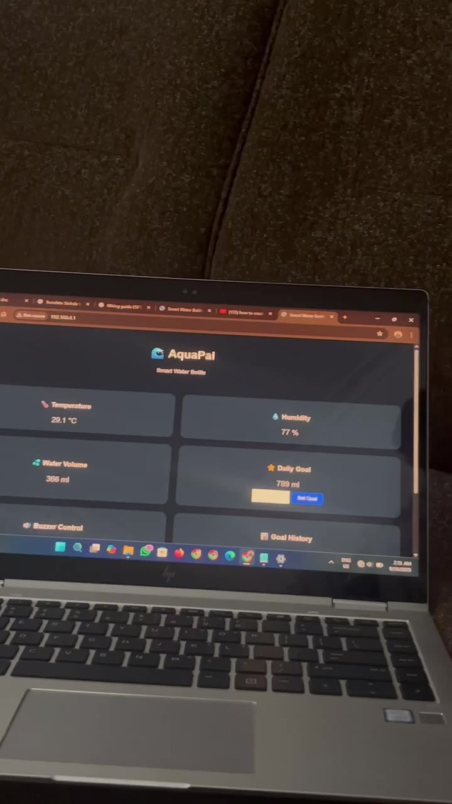

# AquaPal — Smart Water Bottle

**Built: 16 September 2025** · **Board: ESP32-C3 SuperMini** · **Status: completed hardware prototype**

I built AquaPal to try turning a regular water bottle into a small connected device. The idea was to see how far I could go with an ESP32-C3, a few sensors, a small screen, and a web interface. I started on a breadboard, worked on a cylindrical enclosure in CAD, and eventually put the electronics together with the bottle.

The short video below is from the actual 2025 project. The photos on this page are frames taken from that same recording — they are not generated or stock images. The CAD image is a frame of the design shown on screen.

**[Watch the original AquaPal demonstration (MP4)](media/AquaPal-demo-2025.mp4)**



## What it does

- Estimates the amount of water left from an ultrasonic distance reading.
- Shows information on a small OLED display.
- Provides a local browser dashboard for hydration and ambient conditions.
- Uses a DHT11 to read the surrounding temperature and humidity.
- Includes a real-time clock, touch input, and a buzzer for timed reminder functionality in the documented design.
- Fits inside a bottle-mounted enclosure designed in CAD.

**A note about code and project history:** The original September 2025 Arduino sketch has not been recovered for this repository. The `firmware/` folder contains a **new reference implementation written in 2026** using the hardware and behaviour described for AquaPal. It is not presented as the exact code used in the video. The demo footage is historical; the new sketch still needs to be compiled, wired, calibrated, and validated on hardware.

## The original build

| Breadboard prototype | Enclosure design | Browser dashboard |
| --- | --- | --- |
|  |  |  |

The video shows the prototype board, the design process, the assembled bottle, and a dashboard with water volume, temperature, humidity, a daily goal, and intake history. The reconstructed dashboard is a fresh lightweight implementation of the same concept, not a pixel-perfect copy of the 2025 interface.

## Hardware

| Part | Job |
| --- | --- |
| ESP32-C3 SuperMini | Main controller and Wi-Fi access point |
| HC-SR04 ultrasonic module | Water surface distance |
| DHT11 | Ambient temperature and humidity |
| DS3231 RTC | Calendar time and day changes |
| 0.96-inch SSD1306 OLED | On-device display |
| TTP223 touch module | Switch display pages / acknowledge reminder |
| Buzzer | Hydration reminder |
| Water bottle and custom enclosure | Physical assembly |

The bottle used for the project was described as approximately **2 L**. The reference firmware assumes that capacity, but the actual ultrasonic full/empty distances and GPIO assignments must be measured on the physical build.

See [hardware notes](hardware/wiring-example.md) before connecting the ultrasonic sensor. **Do not feed an HC-SR04's 5 V Echo pin directly into an ESP32-C3 GPIO.**

## How the reference firmware works

```text
HC-SR04 distance ──> median filter ──> approximate water volume ──┐
                                                               ESP32-C3 ──> OLED
DHT11 ─────────────────────────────────────────────────────────────┤         ├──> buzzer
DS3231 clock ──────────────────────────────────────────────────────┤         └──> local web dashboard
TTP223 touch ──────────────────────────────────────────────────────┘
```

The sketch waits for multiple similar level measurements before accepting a change. A large drop is treated as estimated intake; a rise is treated as a possible refill. A buzzer can remind the user after a configurable interval. The ESP32-C3 hosts a local Wi-Fi network and browser page, so this sample does **not** need a cloud account or internet connection.

This is a basic level-difference estimate, not an accurate drink detector. Tilting or moving the bottle can produce misleading readings. Measurement accuracy and refill recognition have not been benchmarked against physical measurements. See [limitations and testing](docs/testing-and-limitations.md).

## Getting the code running

1. Install the **ESP32 by Espressif Systems** board package in Arduino IDE. Select an appropriate ESP32-C3 board (often **ESP32C3 Dev Module**).
2. Install **Adafruit GFX Library**, **Adafruit SSD1306**, **DHT sensor library** (plus its dependency **Adafruit Unified Sensor**), and **RTClib**.
3. Copy `firmware/AquaPal/config.example.h` to `firmware/AquaPal/config.h`.
4. Change the example Wi-Fi password and **confirm every GPIO connection and the calibration values** for your own assembled hardware.
5. Open `firmware/AquaPal/AquaPal.ino`, upload, and open the Serial Monitor at **115200 baud**.
6. Connect your phone/laptop to the configured **AquaPal Wi-Fi network** and open **http://192.168.4.1/**.

The example connections are listed in [hardware/wiring-example.md](hardware/wiring-example.md). They are **not an independently verified pinout of the 2025 prototype**.

The dashboard includes status, estimated remaining water, estimated daily intake, goal progress, ambient temperature/humidity, reminder timing, and basic settings. The configurable reminders start at 30 minutes by default.

## Repository contents

```text
firmware/AquaPal/       Arduino IDE sketch, tracker, dashboard and example configuration
hardware/               Parts and example GPIO/safety notes
docs/                   Design notes, calibration, limitations and publishing notes
media/                  Original 2025 video and genuine frames taken from it
tests/                  Desktop test for the level-change tracking logic
```

Run the core algorithm test without an ESP32:

```bash
g++ -std=c++17 -Wall -Wextra tests/test_tracker.cpp -o /tmp/aquapal_test
/tmp/aquapal_test
```

That test covers basic initialization, noise tolerance, estimated intake, refill behaviour and daily reset. It does not replace hardware testing or prove measurement accuracy.

## What I learned

This build gave me practical experience integrating sensors, using I²C peripherals, thinking about small displays, and designing an enclosure around electronics instead of leaving everything on a breadboard. It also highlighted a real limitation of this type of device: estimating the water volume is easy in principle, but getting reliable drinking measurements while someone actually uses a bottle is much harder.

If I revisit it, I would improve tilt/movement detection, calibrate the bottle with measured fill levels, reduce the enclosure size, and revisit power management. Those are **future improvements**, not features claimed for the 2025 demo.

---

**Original project:** 16 September 2025  
**Repository documentation and reconstructed example:** 2026  
**Author:** [Dileepa Nayanajith](https://github.com/DileepaNayanajith)
